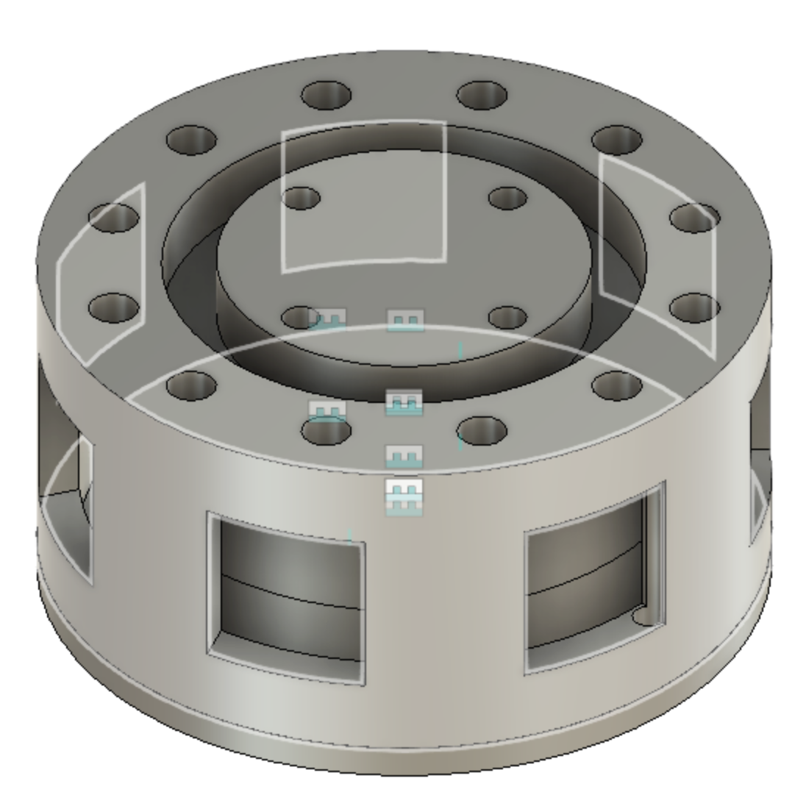
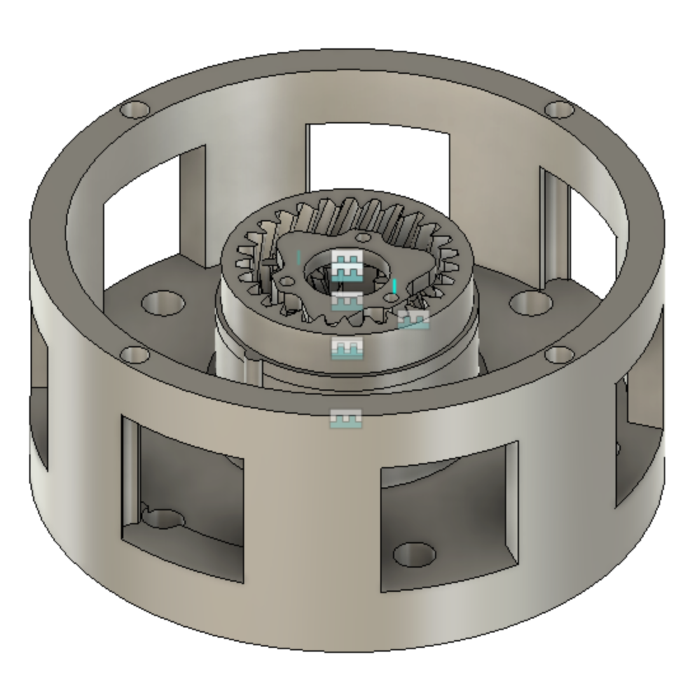
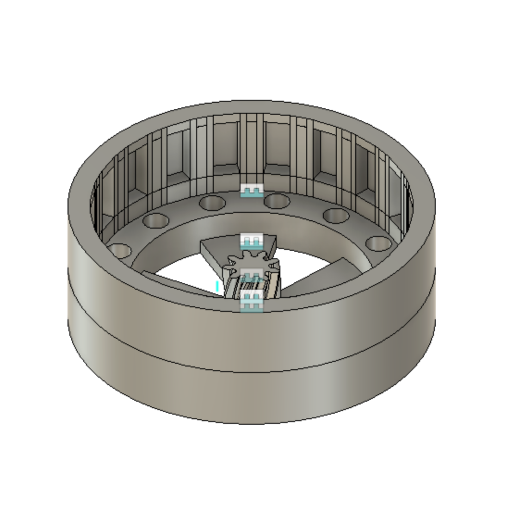
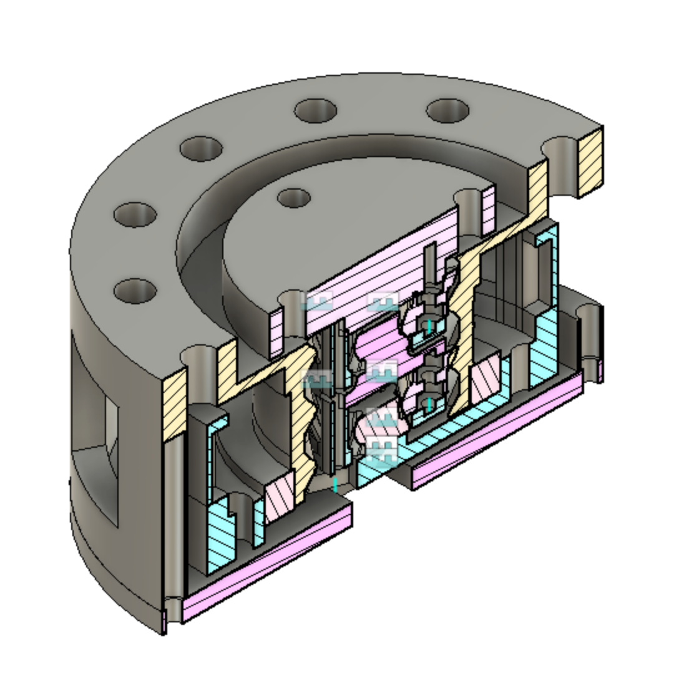
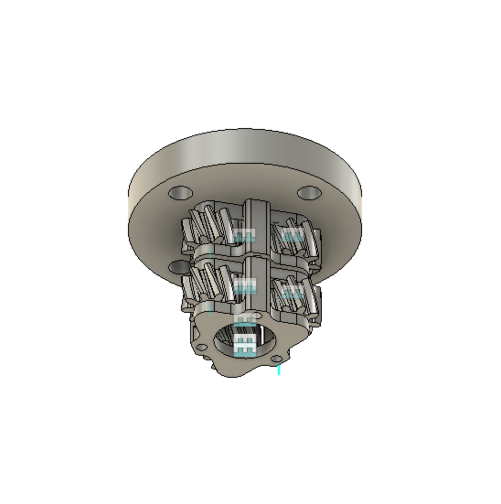

# QDD Actuator Design & Rationale

This repository contains the design files for a custom-built, low-cost brushless actuator. My primary goal was to develop an actuator with a final assembled cost of around **$40** and a total weight of under **500g**. Every design decision, from component sourcing to mechanical design, was made to balance performance with this strict cost constraint.

## Design Files & Previews

This repository is organized into preview images and the complete STL design files needed for 3D printing.

### Preview Images

These top-level PNG files provide various views of the assembled actuator:

* `cross_section_view.png`: A cross-section of the entire actuator, showing the gearbox.
* `full_view.png`: The fully assembled actuator.
* `full_view_no_backplate.png`: View with the backplate removed.
* `full_view_no_output.png`: View with the output hub removed.
* `full_view_no_rotor.png`: View with the rotor removed to show the stator.
* `full_view_only_rotor.png`: An isolated view of the rotor assembly.

### CAD / STL Files

The 3D printable components are located in the `design files` directory:

* `design files/`
    * `Backplate.stl`
    * `Frame.stl`
    * `Rotor.stl`
    * `gearbox/`
        * `Carrier.stl`
        * `First Stage Output Sun Gear.stl`
        * `Planet Gear.stl`
        * `Second Stage Output.stl`

---

## Component Breakdown & Design Decisions

Below is a breakdown of each major component, explaining the choices I made during the design process.

### Stator

The stator was the central component that dictated much of the motor's overall design. Since stators require specific materials for efficiency, they can be difficult and expensive to source in the US.

* **Sourcing & Cost:** I turned to **Alibaba** to find a supplier for a **6010** size stator, which I selected to meet my target weight of 500g. While the per-unit cost was low (~$2), the shipping and import fees were substantial. The final cost breakdown for 12 stators was $24 for the parts, $30 for import fees, and $56 for shipping, bringing the cost to **$9.00 per stator**.
* **Winding:** I experimented with different wire gauges to balance torque, heat, and current draw. 36 AWG wire got too hot, and 24 AWG wire drew too much current for my chosen driver. I settled on **28 AWG wire**, winding **40 loops per slot**. This provided a good balance of acceptable current usage and adequate torque. The wire cost was **$2.00**.

### Motor Frame & Rotor

The frame and rotor were designed around the sourced stator and magnets, with a focus on cooling and cost-effectiveness.

* **Frame:** I opted for an **open-frame design** to aid in passive cooling. While this slightly reduces structural rigidity, it was a worthwhile trade-off to manage heat without adding complexity or cost. The frame and other parts are 3D printed, costing about **$5.00** in plastic.
* **Rotor:** For the rotor, I needed magnets that were powerful, cheap, and fit within the size constraints. I chose **12x3x6mm N52 magnets**, as they were the largest I could find on Alibaba/Amazon that met my budget. I used 20 magnets per rotor for a total cost of **$4.80**.

### Gearbox

To achieve my target torque, I integrated a compact, two-stage planetary gearbox.

* **Performance Goals:** My initial goal was to get **0.16 Nm** of torque from the base motor. With the **1:3** and **1:4** stages of my gearbox, this multiplies to a final output torque of **~2 Nm**.
* **Future Plans:** My next goal is to refine the motor windings to achieve 0.7 Nm from the base motor, which would result in a total output torque of nearly **10 Nm**.
* **Cost:** The mini bearing used for the gear and carrier cost **$2.70**.

### Bearings

To keep costs down, I sourced the cheapest bearings I could find and designed the actuator around them.

* The large **output bearing** ($4.50) was selected first, and the output shaft was designed to match.
* The smaller **bearing between the rotor and frame** ($3.50) was chosen to fit the inner diameter of the 6010 stator.

### Electronics

* **Encoder:** I chose the **AS5600 magnetic encoder** because it offered the best performance for its price. At the operational speeds of this actuator, it provides reliable, high-quality position feedback for just **$3.25**.
* **Motor Driver:** The **DRV8313** was the most cost-effective driver I could find that met my needs. It can handle up to **2.5A continuous** and **3.5A peak current**, which is sufficient for my 28 AWG windings. All other controllers were significantly more expensive and would have pushed the project over budget. The driver cost **$8.00**.

---

## Final Cost Summary

By carefully sourcing parts and making strategic design trade-offs, I was able to meet my target cost of around $40 per actuator.

| Item | Cost per Unit | Notes |
| :--- | :--- | :--- |
| Stator 6010 | $9.00 | $24 parts + $30 import + $56 shipping for 12 units |
| Plastic (3D Printed Parts) | $5.00 | Frame, rotor, gear carrier, etc. |
| Large Output Bearing | $4.50 | |
| Small Bearing (Rotor to Frame) | $3.50 | |
| Mini Bearing (Gear and Carrier) | $2.70 | |
| Magnets (20 per rotor) | $4.80 | 12x3x6mm N52 magnets |
| Wire (28 AWG) | $2.00 | |
| Encoder (AS5600) | $3.25 | |
| Driver (DRV8313) | $8.00 | |
| **Total Cost Per Actuator** | **$42.75** | |
| **Total Cost for 12 Actuators** | **$513.00** | |
